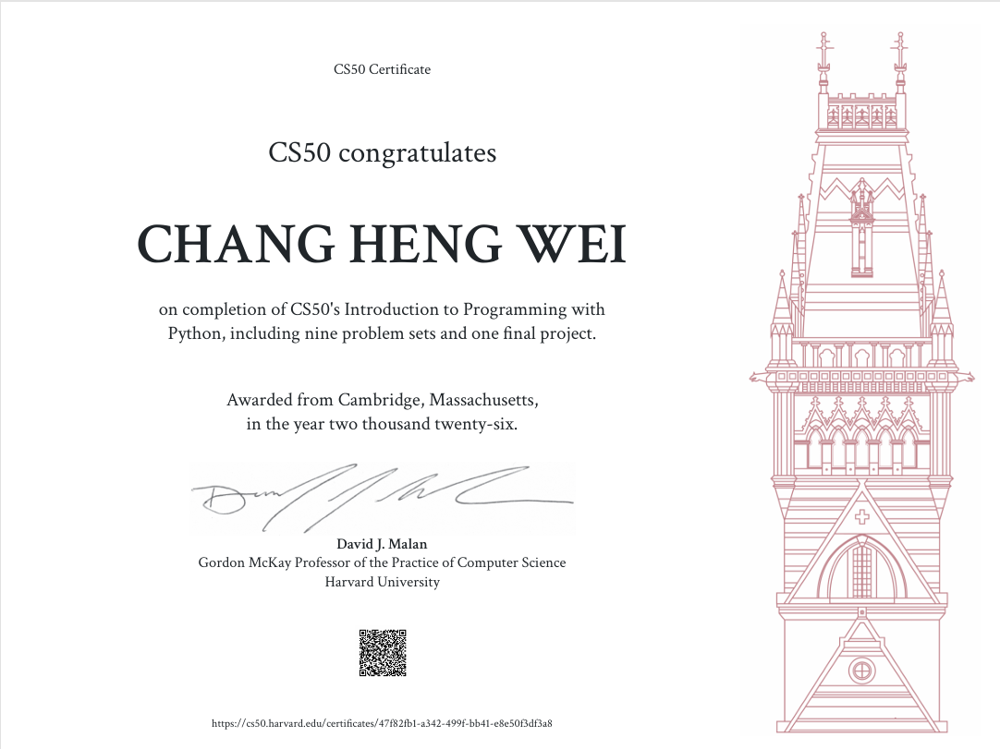
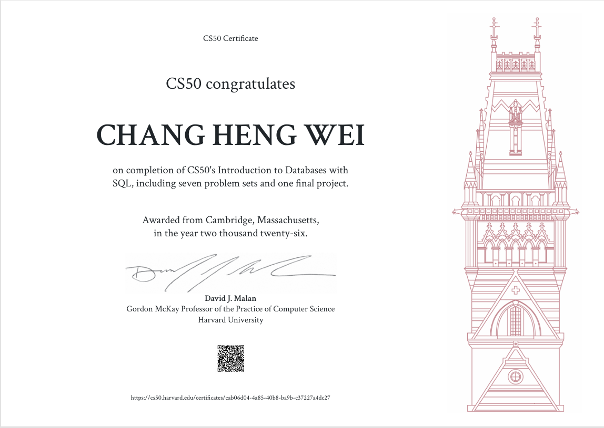

## CS50's Introduction to Programming with Python

Mastered procedural and object-oriented Python programming, file I/O operations, regular expressions, and unit testing with pytest. Applied core engineering practices to solve complex problem sets and develop an end-to-end Python project.
  

## CS50's Introduction to Databases with SQL

Mastered database design, relational modeling, and SQL queries (joins, aggregations, subqueries, indexes). Applied concepts by designing and implementing a relational database schema for a custom Fitness & Nutrition Tracker final project.
